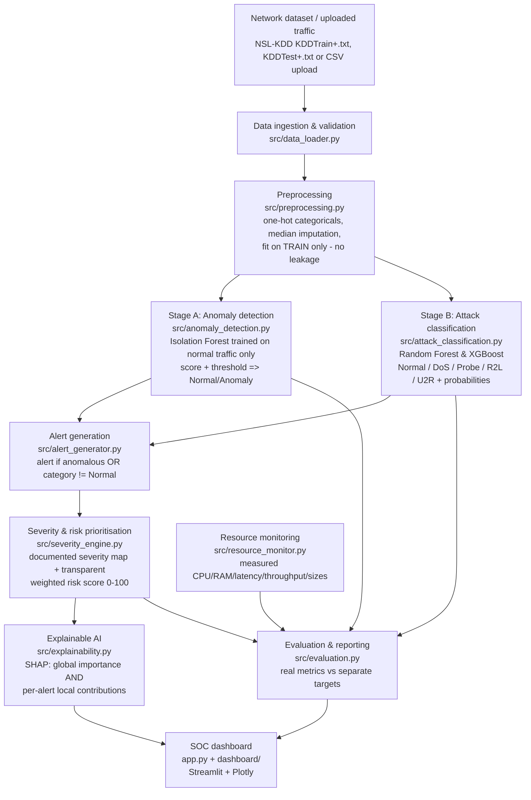

# AI-Assisted Network Anomaly Detection and Alert Triage for Resource-Constrained SOCs

An undergraduate Computer Science final-year **research prototype** demonstrating how machine
learning can assist a small or resource-constrained Security Operations Centre (SOC) in:

1. Detecting anomalous network traffic (unsupervised).
2. Classifying traffic into attack categories (supervised).
3. Prioritising alerts with transparent severity and risk scoring.
4. Explaining predictions to analysts with SHAP (global and per-alert).
5. Measuring its own computational resource requirements.

> **Scope statement.** This is an academic research prototype evaluated on the historical
> NSL-KDD benchmark. It is **not** a production IDS/SIEM, has **not** been validated on live
> enterprise traffic or deployed in a real SOC, and does **not** replace human analyst
> judgement. See [Limitations](#limitations).

---

## Research objectives

| # | Objective | Where implemented |
|---|-----------|-------------------|
| 1 | Detect anomalous traffic with ML | `src/anomaly_detection.py` (Isolation Forest, trained on normal traffic only) |
| 2 | Classify attacks into 5 categories | `src/attack_classification.py` (Random Forest + XGBoost) |
| 3 | Prioritise alerts for investigation | `src/alert_generator.py`, `src/severity_engine.py` |
| 4 | Explain alerts to analysts | `src/explainability.py` (SHAP, global **and** local) |
| 5 | Evaluate detection + resource cost | `src/evaluation.py`, `src/resource_monitor.py`, `train.py` |
| 6 | Present results interactively | `app.py` + `dashboard/` (Streamlit) |

## System architecture



The layers are independent: ML (Stage A/B), triage, explainability and presentation can each
be tested and improved separately (`tests/`).

## Technology stack

Python 3.14 · scikit-learn 1.9 · XGBoost 3.4 · SHAP 0.54 · pandas · NumPy · Plotly ·
Streamlit 1.67 · joblib · psutil · ReportLab (PDF reports) · pytest
(see `requirements.txt` for exact pinned versions).

## Project structure

```text
ai_soc_prototype/
├── app.py                  # Streamlit shell: theme, navigation, status footer
├── train.py                # reproducible training + evaluation pipeline
├── config.py               # research defaults: paths, seed, hyperparams, severity map, risk weights
├── requirements.txt
├── .env.example            # auth config template (placeholders only, no secrets)
├── .streamlit/config.toml  # dark SOC palette (also enforced by dashboard/components.py)
├── data/raw/               # KDDTrain+.txt, KDDTest+.txt (download, see below)
├── data/processed/         # alerts.csv, alert_statuses.json, alert_notes.json, app_settings.json, auth.db, analysis_cache/
├── models/                 # *.pkl artefacts + preprocessing.json + pipeline_state.json
├── src/
│   ├── data_loader.py      # ingestion + validation (explicit quality reports)
│   ├── preprocessing.py    # encoding pipeline, persisted config
│   ├── anomaly_detection.py# Stage A: Isolation Forest
│   ├── attack_classification.py # Stage B: RF + XGBoost
│   ├── alert_generator.py  # alerts + store (status workflow and analyst notes)
│   ├── severity_engine.py  # severity map + transparent risk score
│   ├── explainability.py   # SHAP global/local
│   ├── resource_monitor.py # real CPU/RAM/latency/throughput measurements
│   ├── evaluation.py       # anomaly/classification/triage metrics vs targets
│   ├── settings.py         # validated, persisted analyst-editable runtime settings + activity log
│   ├── pipeline.py         # the seven measured stages shared by every page and test
│   ├── analysis_cache.py   # disk persistence of the default analysis (survives restarts)
│   ├── reporting.py        # report payload + real CSV/JSON/PDF exports
│   └── auth/               # real authentication: settings, db, security, service, rbac, mail
├── dashboard/
│   ├── components.py       # design system: palette, icons, cards, badges, charts, tables
│   ├── common.py           # cached loaders (models, artefacts, alerts, dataset, live readings)
│   ├── auth_ui.py          # branded auth pages, session gate, remember-me bridge, account panel
│   ├── nav.py              # role-filtered page registry (st.navigation / st.switch_page)
│   └── pages/              # one module per page (11 pages, listed below)
├── scripts/
│   ├── download_dataset.py
│   ├── experiment_detection.py  # validation-split tuning experiments (KDDTest+ never read)
│   ├── send_test_email.py       # operator-run real-delivery check
│   ├── allow_lan_access.ps1     # operator-run (admin): Private Wi-Fi + LAN-only firewall rule
│   └── provision_admin.py  # operator-run secure bootstrap of the first administrator
├── docs/AUTHENTICATION.md  # auth architecture, setup, configuration, limitations
├── tests/                  # pytest suite (synthetic fixtures + real-artefact page + auth tests)
└── results/
    ├── metrics/            # evaluation.json, resource_metrics.json, global_shap_importance.json
    ├── figures/
    ├── reports/            # training_report.md + generated PDF reports
    └── app_activity.log    # capped settings/workflow log (no secrets, no absolute paths)
```

## Dataset

The system uses **NSL-KDD** (Tavallaee et al., 2009), the corrected version of KDD Cup 99:

- `KDDTrain+.txt` — 125,973 records
- `KDDTest+.txt` — 22,544 records

Place both files in `data/raw/`. They are not redistributed here; download them from the
UNB CIC NSL-KDD dataset page (search "NSL-KDD dataset"), or run the helper:

```bash
python scripts/download_dataset.py   # fetches from a public mirror and verifies record counts
```

Each line has 41 features, the attack label and a difficulty score.

**Attack → category mapping** (documented, in `config.ATTACK_CATEGORY_MAP`):

| Category | NSL-KDD attack labels |
|----------|----------------------|
| Normal | `normal` |
| DoS | back, land, neptune, pod, smurf, teardrop, apache2, udpstorm, processtable, worm, mailbomb |
| Probe | satan, ipsweep, nmap, portsweep, mscan, saint |
| R2L | guess_passwd, ftp_write, imap, phf, multihop, warezmaster, warezclient, spy, xlock, xsnoop, snmpgetattack, httptunnel, sendmail, named, snmpguess |
| U2R | buffer_overflow, loadmodule, perl, rootkit, sqlattack, xterm, ps |

Records are never silently discarded: malformed rows, invalid numeric cells, duplicates and
unknown labels are counted and reported by the validation layer (visible in the dashboard).

## Installation

```bash
cd ai_soc_prototype
python -m venv .venv
# Windows
.venv\Scripts\activate
# Linux/macOS
source .venv/bin/activate
pip install -r requirements.txt
```

## Training (reproducible)

```bash
python train.py
```

This trains all three models (seed 42, `config.RANDOM_SEED`), saves artefacts to `models/`,
evaluates on KDDTest+, computes global SHAP importance, generates + stores test-set alerts,
records resource measurements, and writes:

- `results/metrics/evaluation.json` — all real evaluation numbers
- `results/metrics/resource_metrics.json` — measured CPU/RAM/latency/sizes
- `results/reports/training_report.md` — human-readable summary
- `models/pipeline_state.json` — training date, record counts, library versions

Options: `--skip-eval` (train only), `--shap-sample N` (global SHAP sample size).

## Running the dashboard

```bash
streamlit run app.py
```

The dashboard is gated behind real server-side authentication (see
[Authentication & access control](#authentication--access-control)). Once signed
in, eleven pages are available, each backed by the real artefacts (no mock data
anywhere); the navigation is filtered to the signed-in role:

| Page | What it shows |
|------|---------------|
| **Overview** | Six metric cards from a live pipeline run and the persisted alert store, traffic doughnut, predicted vs ground-truth attack distribution, severity distribution, recent alerts (click through to triage), system health with real `psutil` readings |
| **Traffic Analysis Monitor** | Runs the seven stages over the selected NSL-KDD file, shows measured per-stage timings, filters and paginates the per-record results, exports CSV. Explicitly labelled as static-data analysis: no packet capture, no live feed, no invented timeline |
| **Network Analysis** | Upload a CSV/TXT/DATA file (size + extension validated, parsed as data only), inspect the validation report and file metadata, or load a built-in dataset; real progress bar driven by stage completion; download results; optionally push alerts to the store |
| **Alert Management** | Summary cards, searchable/filterable/sortable triage queue, investigation view with the two-stage explanation, rule-based recommendations **labelled as suggestions**, on-demand local SHAP, persisted status workflow and timestamped analyst notes |
| **Attack Intelligence** | Per-category counts and per-class precision/recall/F1 for both classifiers, confusion matrices (counts or row-normalised), and a misclassified-example inspector that can hand a record to the Explainable AI page. Documented NSL-KDD family characteristics only — no invented threat intelligence |
| **Explainable AI** | Global mean absolute SHAP (cached, labelled model-level) kept strictly separate from local per-alert explanations: real waterfall from base value to final output, ranked contributions, plain language generated from those values, measured latency, graceful failure |
| **Model Performance** | Isolation Forest, Random Forest and XGBoost reported separately, comparison view, stored ROC plus on-demand ROC/precision-recall curves (labelled "computed live"), train vs test provenance, research targets vs actuals |
| **Resource Monitoring** | Measured training/inference timings, batched latency and throughput, model file sizes, explainability overhead, fresh CPU/memory samples with a session time series, and an explicit measurement-environment + limitations statement |
| **Reports** | Preview and export a real PDF (ReportLab) plus CSV/JSON: dataset and configuration, methodology, this run's results and stage timings, alert triage, model performance, explainability, resource measurements, limitations |
| **System Settings** | Validated editors for dataset, classifier, anomaly threshold, severity map, risk weights, SHAP options and display preferences; model/dataset information, software versions, activity log, reset to research defaults. Administrator only |
| **User Management** | Administrator only: list accounts, change roles, enable/disable accounts, revoke sessions and read the security audit feed. Self-role-change and self-disable are refused to prevent lockout |

**Design system.** `dashboard/components.py` holds the palette (background `#080F1D`,
sidebar `#0B1424`, cards `#111D30`, accent `#38BDF8`, severity colours
`#EF4444`/`#F97316`/`#EAB308`/`#22C55E`), 10–14 px radii, inline SVG icons, cards,
badges, chips, stage trackers, paginated tables and Plotly theming. Severity is
never conveyed by colour alone: every badge carries a text label and a shape glyph.
The layout is responsive down to narrow windows and the sidebar collapses.

**Data integrity rules enforced in the UI.** No fabricated alerts, no hardcoded
predictions, no fake SHAP values, no simulated CPU/memory readings, no claim of live
traffic, ground-truth labels always labelled as ground truth (never shown as
predictions), training and test metrics never mixed without identification, weak
model results shown rather than hidden, and the severity map always described as a
research heuristic. Anything not measured renders as *not measured* / *not available*.

**Runtime settings** (`src/settings.py`) are validated before they are written to
`data/processed/app_settings.json`; invalid input is rejected with a message and
nothing is persisted. Defaults always come from `config.py`, so deleting the file
restores the documented research configuration. Pages that depend on a setting show
a drift notice when the current configuration differs from those defaults.

**Performance and caching.** Model artefacts are loaded once per server process
(warmed at startup in `app.py`), and the dataset analysis is cached process-wide
so signing in or moving between pages reuses the result instead of re-running the
pipeline. The default analysis (full dataset, no on-demand SHAP) is also persisted
to `data/processed/analysis_cache/` (parquet frames + JSON stage timings/meta) and
reused after a server restart. A persisted entry is only reused when its key —
every output-affecting setting plus the model `trained_at` fingerprint — matches
the current configuration, so editing settings or retraining transparently
triggers a fresh real run; missing or corrupt entries are ignored. Severity/risk
scoring is vectorised (numpy) and produces values identical to the per-row
formula (covered by a parity test). None of this fabricates results: a cache hit
replays a previously measured real run, and the activity log records when an
analysis is restored from disk.

## Authentication & access control

The whole dashboard sits behind a real authentication system (no mock login).
Unauthenticated visitors only ever see the branded sign-in / registration /
recovery pages; the shell and every page render after a valid server-side
session, and each page is permission-checked on the server.

```bash
cp .env.example .env                # placeholders only; never commit a real .env
python scripts/provision_admin.py   # interactive, hidden input: first administrator
streamlit run app.py
```

- **Roles:** Administrator, SOC Analyst, Researcher / Viewer. New registrations
  are always least-privileged viewers; only an administrator grants more, and
  self-escalation / self-disable are refused. Permissions are enforced in the
  service layer and at the page gate, not by hiding controls.
- **Credentials:** Argon2id hashing, ≥12-character policy (upper/lower/digit/
  special, passphrases welcome), generic login failures, sliding-window
  lockout, single-use expiring recovery/verification tokens. Passwords and
  tokens are never stored in plaintext, logged, or shown.
- **Sessions:** opaque tokens stored only as SHA-256 digests, expiry, logout,
  admin revocation, and password-change invalidation of all other sessions.
  Remember-me uses a `SameSite=Strict` cookie (`Secure` over HTTPS).
- **Email:** `off` / `outbox` (labelled development mode) / `smtp`. Real sending
  uses a transactional provider preset (`AI_SOC_EMAIL_PROVIDER` = sendgrid,
  brevo, mailgun, postmark, ses or gmail) with one server-side sending
  credential — users never share it. If delivery is not configured the UI states
  the limitation honestly rather than faking a verification success.

Full architecture, configuration reference, CSRF/transport posture and
limitations: **[docs/AUTHENTICATION.md](docs/AUTHENTICATION.md)**. Change the
provisioned administrator password on first sign-in.

## Models

| Stage | Model | Training data | Output |
|-------|-------|---------------|--------|
| A — anomaly detection | Isolation Forest (200 trees, max_samples 0.8) | **normal training traffic only** | anomaly score + Normal/Anomaly decision vs the threshold saved with the model (10% quantile of normal training scores — a recall-oriented operating point; `config.ANOMALY_THRESHOLD` is only the pre-training fallback). Overridable live in the dashboard |
| B — classification | Random Forest (200 trees, `class_weight="balanced"`) | labelled training traffic (5 categories) | category + class probabilities |
| B — classification | XGBoost (300 rounds, depth 6, lr 0.15, hist, balanced sample weights) | labelled training traffic | category + class probabilities |

An anomaly is **not** assumed to be any particular attack: Stage A and Stage B are separate
decisions, both recorded on each alert.

## Alert triage

An alert is created when **either** stage flags a record (anomalous OR predicted category ≠
Normal). Each alert carries: unique ID, timestamp, detection status, predicted category,
severity, risk score, model confidence, anomaly score, plain-language explanation,
recommended action and investigation status (**New / Investigating / Resolved / False
Positive**), persisted across sessions in `data/processed/`. Analysts can attach
timestamped investigation notes (`alert_notes.json`); notes and statuses survive alert
regeneration for alerts that still exist and are pruned for alerts that no longer do.

**Severity map** (initial research rules in `config.SEVERITY_MAP`, editable and validated
on the System Settings page — *not* a professionally validated SOC risk framework):

| Category | Severity |
|----------|----------|
| Normal | Informational |
| Probe | Medium |
| DoS | High |
| R2L | High |
| U2R | Critical |

**Risk score** (0–100, fully transparent; default weights in `config.RISK_WEIGHTS`,
editable and validated on System Settings — the three weights must sum to 1.0):

```
risk = 100 * ( 0.5 * severity_weight(category)      # Critical=1.0 … Informational=0.0
             + 0.3 * model_confidence               # max class probability
             + 0.2 * anomaly_component )            # 0 at threshold → 1 at threshold−0.5
```

`anomaly_component` is normalised against the **effective** threshold (the model's saved
threshold, or the analyst override when one is set), so the anomaly decision and the risk
score always use the same reference point. This is a research prioritisation heuristic,
not a validated real-world risk measurement.

## Explainability

- **Global** feature importance: mean |SHAP| over a sample of records (dataset-level; the UI
  labels it explicitly as *global*, never as per-alert).
- **Local per-alert** SHAP: computed on demand for a single record and predicted class,
  showing features pushing toward/against the prediction, with measured latency. TreeExplainer
  is exact for both RF and XGBoost; explanations are computed lazily so the alert pipeline is
  not slowed down.

## Evaluation methodology

All numbers in the dashboard come from `results/metrics/*.json`, produced by `train.py` on
KDDTest+ (no training records). Metrics:

- **Anomaly detection:** ROC-AUC, precision, recall, FPR, FNR, confusion matrix.
- **Classification (RF and XGBoost, compared):** accuracy, macro/weighted F1, per-class
  P/R/F1, confusion matrices, strongest/weakest category.
- **Triage:** alerts by severity/category/status, prioritised & investigated counts, false
  positives vs ground truth where available.
- **Resource efficiency:** training time, batched prediction latency (ms/record), throughput,
  CPU %, process RSS, model file sizes, SHAP latency — all measured with `psutil` /
  `perf_counter` on the machine running the pipeline. Unmeasurable values are reported as
  *not measured*, never invented.

Research **targets** (`config.EVALUATION_TARGETS`) are displayed **separately** from actuals;
a numeric `target_met` comparison is shown but never presented as a validated claim.

**Tuning methodology (no test-set leakage).** Detection-quality choices — cost-sensitive
class weighting for both classifiers and the recall-oriented Stage A operating point — were
selected by `scripts/experiment_detection.py` on a **stratified 80/20 validation split carved
from KDDTrain+ only** (preprocessing fitted on the fit portion; results in
`results/metrics/detection_experiment.json`). KDDTest+ was never read during tuning; it is
used exactly once per training run for the honest final evaluation above. Because the
validation split is in-distribution while KDDTest+ contains novel attack variants, validation
scores rank configurations against each other and are **not** comparable to the test scores.
The pre-change test baseline is preserved in
`results/metrics/evaluation_baseline_pre_weighting.json` for before/after comparison.

**Measured effect of the change (KDDTest+, held out):**

| Metric | Before | After |
|--------|--------|-------|
| XGBoost accuracy | 0.7807 | 0.7882 |
| XGBoost macro-F1 | 0.5594 | 0.5975 |
| XGBoost U2R F1 | 0.1795 | 0.3333 |
| XGBoost Probe recall | 0.6365 | 0.7410 |
| XGBoost R2L F1 | 0.2038 | 0.1639 *(regressed)* |
| Random Forest macro-F1 | 0.4755 | 0.5046 |
| Stage A recall | 0.7464 | 0.7830 |
| Stage A false-positive rate | 0.0904 | 0.1074 *(recall/precision trade-off)* |

Stage A ROC-AUC is unchanged (0.9483): the model and scores are identical, only the
operating point moved. The XGBoost R2L regression and the still-unmet targets (macro-F1
0.70, anomaly recall 0.90, ROC-AUC 0.95) are reported as-is: novel attack variants in
KDDTest+, not class weighting, remain the dominant generalisation bottleneck.

## Testing

```bash
pytest tests/ -v
```

Unit tests use small synthetic NSL-KDD-shaped fixtures (fast, no dataset needed) and cover
loading, validation (bad extensions/sizes/columns, malformed rows, unknown labels),
preprocessing (encoding, imputation, leakage, persistence), both stages (fit/predict/save/
load, threshold configuration, stage independence), alerts (generation rule, fields, store,
status workflow, filters, analyst notes and note pruning), severity/risk (mapping,
monotonicity, exact formula), SHAP (local vs global distinction), evaluation metrics,
resource-measurement honesty, settings validation/persistence, the seven-stage pipeline
(including failure and skip paths and the progress callback) and report assembly/PDF/CSV
export.

`tests/test_dashboard.py` additionally executes **every dashboard page** through
Streamlit's `AppTest` harness against the real artefacts, so a broken page fails the suite
instead of silently rendering an empty screen. Those tests are skipped automatically when
the models or the NSL-KDD test file are absent.

`tests/test_dashboard_interactions.py` drives the **write paths** the same way: saving and
rejecting settings, resetting to defaults, changing an alert status, the confirmation gate
before closing an alert, adding an investigation note, generating a local SHAP explanation,
running the built-in dataset through the pipeline and exporting/saving its alerts, and
generating plus saving the PDF report. Every persisted artefact (alert store, statuses,
notes, settings file, activity log, report directory) is redirected to a temporary folder,
so the suite never modifies your analyst state.

`tests/test_auth.py` and `tests/test_auth_ui.py` cover the authentication system:
registration (least privilege, no role parameter, rate limits, digest-only token
storage), login (generic errors, lockout incl. unknown identifiers), sessions
(expiry, logout, password-change invalidation, admin revoke), recovery and
verification (single-use, expiry, honest mail-mode messages), RBAC/admin guards,
audit (events recorded, no secrets), and the real Streamlit auth pages driven
through `AppTest` (gate, signup, login, remember-me, reset via a real outbox link,
viewer read-only triage, admin user management), plus the hardening features:
password history, idle session timeout, TOTP two-factor enrol/login/disable
(`tests/test_mfa.py`) and breach-password screening (`tests/test_breach.py`).
The auth fixtures redirect the database and mail outbox to a temporary folder.
Current total: **358 passing tests**.

## Sample demonstration workflow

1. `python train.py` → show the console log: training times, real KDDTest+ metrics.
2. `streamlit run app.py` → **Overview**: records analysed, normal vs anomalous, alerts by
   severity, system health; click a recent alert to jump into triage.
3. **Traffic Analysis Monitor** → run the seven stages over KDDTest+ and show the measured
   per-stage timings and the per-record table (predicted category next to ground truth).
4. **Model Performance** → RF vs XGBoost comparison, confusion matrices, ROC, targets vs
   actuals (note the weak R2L/U2R results are displayed, not hidden).
5. **Alert Management** → filter Critical/U2R, open one alert, read the two-stage
   explanation and the suggestions, generate its local SHAP explanation, add an
   investigation note, set status to *Investigating* → reload to show persistence.
6. **Explainable AI** → global importance (labelled model-level), then the local waterfall
   for the same alert with base value, contributions and measured latency.
7. **Attack Intelligence** → per-category performance, then inspect a misclassified record
   and hand it to Explainable AI.
8. **Network Analysis** → upload a CSV (or load a built-in dataset), watch the real progress
   bar, inspect validation, download results, optionally add alerts to the store.
9. **Resource Monitoring** → measured stage timings, ms/record, throughput, model sizes,
   explainability overhead, live CPU/RAM and the environment/limitations statement.
10. **Reports** → generate the PDF and CSV exports from the same real numbers.
11. **System Settings** → change the severity map or risk weights (validation rejects a
    weight set that does not sum to 1), show the drift notice on other pages, then reset.

## Limitations

- **Historical benchmark.** NSL-KDD (1999 capture, de-duplicated and difficulty-scored in
  2009) does not represent modern traffic; performance here does **not** guarantee real-world
  detection performance.
- **Class imbalance.** U2R and R2L are rare; both classifiers use cost-sensitive balanced
  weighting (selected on a training validation split) and metrics are reported per-class and
  via macro-averages. Poor categories are shown, not hidden.
- **Distribution shift.** KDDTest+ contains attack variants absent from training; validation
  scores (in-distribution) are much higher than test scores and are never presented as if
  they were test performance.
- **Generalisation risk.** Encoders are fitted on the training split; unseen categories
  become all-zero one-hot rows (documented behaviour, not an error).
- **No live network integration.** Analysis is batch/file-based; there is no packet capture.
- **Severity/risk rules are research heuristics**, not a validated SOC risk framework.
- **No human evaluation.** Nothing here demonstrates reduced analyst workload; that would
  require a user study (future work).
- **Timestamps.** NSL-KDD records carry no capture times; alert timestamps are analysis-run
  times, so time-trend charts are intentionally not shown as if they were traffic trends.
- **False negatives are possible** and are quantified (FNR, confusion matrices) rather than
  claimed away.

## Future improvements (proposed, not implemented)

- Streaming ingestion (e.g. scapy/Kafka) and online learning.
- External validation on modern datasets (CIC-IDS2017/2018, UNSW-NB15).
- Calibrated probabilities and per-class decision thresholds (threshold calibration was
  experimented with on the validation split but not adopted: gains were noise-level).
- A user study with SOC analysts to evaluate triage usefulness.
- Clustering-based alert de-duplication.
- Model distillation for even smaller hardware.

## Security & reliability notes

- **Deployment posture (LAN-only).** `AI_SOC_APP_URL` points at the server's LAN
  address so email links open on other devices on the same network; the firewall
  rule "AI-SOC Streamlit (LAN)" allows TCP 8501 only from the local subnet on
  Private profiles. No public HTTP exposure — see
  [docs/AUTHENTICATION.md](docs/AUTHENTICATION.md) ("Deployment & reachability").

- Uploads are extension- and size-validated (`config.ALLOWED_UPLOAD_EXTENSIONS`,
  `config.MAX_UPLOAD_BYTES`, mirrored by `.streamlit/config.toml`) and parsed in memory
  strictly as data — never executed and never written to disk.
- Runtime settings are validated before persistence; invalid values are rejected with an
  explicit message and nothing is written. Risk weights must sum to 1.0 and the severity
  map may only contain documented severity levels.
- Models are loaded from local artefacts with clear errors when missing; the dashboard
  shows a "run `python train.py`" notice instead of falling back to simulated output.
- Invalid records produce explicit validation reports instead of crashes; pipeline failures
  are recorded per stage and later stages are left pending rather than faked.
- Authentication stores only Argon2id password hashes and SHA-256 token digests —
  never plaintext passwords, tokens or session secrets. SMTP credentials live in
  `.env`/environment variables (never committed); the activity log, audit log and
  UI show project-relative file names only — no absolute paths, hostnames, user
  directories or credentials. See [docs/AUTHENTICATION.md](docs/AUTHENTICATION.md).
- Password history blocks reuse of the last 5 passwords (configurable) on change
  and recovery reset; sessions expire after 60 minutes of inactivity (configurable)
  in addition to their absolute lifetime. Both are enforced server-side and audited.
- Optional TOTP two-factor authentication (pyotp, RFC 6238): enrol with a QR code
  from the account panel, two-stage sign-in with single-use attempt-limited
  challenges, Fernet-encrypted secrets (`AI_SOC_TOTP_KEY`), and audited admin
  removal as the lost-device recovery path. Without the operator key the UI
  honestly reports MFA as unavailable.
- Optional breach-password screening (`AI_SOC_BREACH_SCREENING`, enabled in this
  deployment): new passwords are checked against the HIBP range API with
  k-anonymity — only a 5-character SHA-1 prefix is transmitted. Outages fail
  open and are audited, never reported as a clean result.
- Destructive actions in the UI (regenerating the alert store, resetting settings, closing
  an alert) require an explicit confirmation step.
